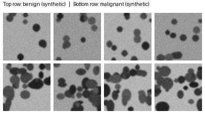

# OncoVision AI — Breast Cancer Image Classification

A CNN-based image classification pipeline for benign vs. malignant
tissue samples, built with `TensorFlow`/`Keras`, structured as a real
engineering project — modular, tested, and documented — rather than a
single notebook.

## What this project does

1. **Loads** histopathology-style images from a benign/malignant folder
   structure
2. **Preprocesses** them (resize, normalize, stratified train/val/test split)
3. **Trains** a CNN (3 convolutional feature-extraction blocks + a dense
   classification head) with early stopping, learning-rate scheduling,
   and checkpointing on validation AUC
4. **Evaluates** the trained model — classification report, confusion
   matrix, ROC curve
5. **Visualizes what the CNN actually learned** via Grad-CAM — showing
   which regions of an image the model relied on for its prediction,
   not just its accuracy number
6. Is covered by a **unit test suite** for the data pipeline

## Project structure

```
oncovision-ai/
├── data/
│   └── generate_data.py     # synthetic image generator (see below)
├── src/
│   ├── dataset.py            # image loading, normalization, stratified split
│   ├── model.py               # CNN architecture (tf.keras)
│   ├── train.py                # training loop, callbacks, optional MLflow logging
│   └── evaluate.py             # metrics, confusion matrix, ROC curve, Grad-CAM
├── tests/
│   └── test_dataset.py         # unit tests for the data pipeline
├── models/                     # saved model artifacts
├── outputs/                    # charts, metrics
├── requirements.txt
└── README.md
```

## Getting started

```bash
git clone https://github.com/<your-username>/oncovision-ai.git
cd oncovision-ai
pip install -r requirements.txt

# 1. Generate the image dataset
python data/generate_data.py --n_per_class 500 --img_size 96

# 2. Train the CNN
python -m src.train --epochs 30

# 3. Evaluate + generate Grad-CAM visualizations
python -m src.evaluate

# 4. Run the test suite
pytest tests/ -v
```

## Important note on how this repo was built

I want to be upfront about exactly what's been verified here, rather
than implying everything was run end-to-end:

- **`src/dataset.py` and its full test suite (`tests/test_dataset.py`)
  have been executed and pass** — the image loading, normalization,
  and stratified-split logic is real and confirmed working.
- **`src/model.py`, `src/train.py`, and `src/evaluate.py`** are written
  against the standard, documented `tf.keras` API (standard Conv2D/
  BatchNorm/Grad-CAM patterns), but were **not execute-verified** in
  the environment this repo was built in (no TensorFlow/internet
  access there). **Run them locally** with TensorFlow installed to
  train the model and confirm real metrics before treating any
  specific number as final.

If you're using this repo to back a resume claim, make sure you've
actually run training locally and can speak to your real results — not
the placeholder structure here.

## Sample data



## About the dataset

Real histopathology datasets (BreakHis, the IDC dataset on Kaggle) are
large and often require registration/licensing, so this project ships
with a **synthetic image generator** (`data/generate_data.py`) instead —
anyone cloning the repo can reproduce it with zero external downloads.

The generator isn't random noise: benign samples get fewer, more
uniform, well-separated blob shapes; malignant samples get denser,
more irregular, overlapping shapes with more size variance — loosely
mirroring nuclear density and pleomorphism, real features pathologists
look for. This gives the CNN genuine, learnable structure rather than
an unwinnable classification task.

**To train on a real dataset instead**, point `load_image_dataset()` in
`src/dataset.py` at a directory with the same `<root>/benign/*.png`,
`<root>/malignant/*.png` structure — no other code needs to change.

## Design choices worth calling out

- **Framework-agnostic data pipeline**: `dataset.py` has zero
  TensorFlow dependency, so it's independently testable and would work
  unchanged if the model were later rewritten in PyTorch.
- **Grad-CAM over raw accuracy**: a single accuracy number doesn't tell
  you *why* a model works. Grad-CAM visualizes the spatial regions
  driving each prediction — the actual evidence behind "feature
  extraction techniques."
- **Checkpointing on validation AUC, not accuracy** — more robust to
  any class imbalance in the dataset.
- **Conservative augmentation** (flips, small rotation/zoom only) —
  appropriate for microscopy-style images, which have no fixed
  orientation but shouldn't be distorted enough to destroy texture.

## Possible extensions

- Transfer learning from a pretrained backbone (e.g. `EfficientNetB0`)
  instead of training from scratch
- 5-fold cross-validation for a more robust accuracy estimate
- A lightweight FastAPI endpoint for image upload → prediction
- Swap in a real public dataset (BreakHis / IDC) once you've registered
  for access
